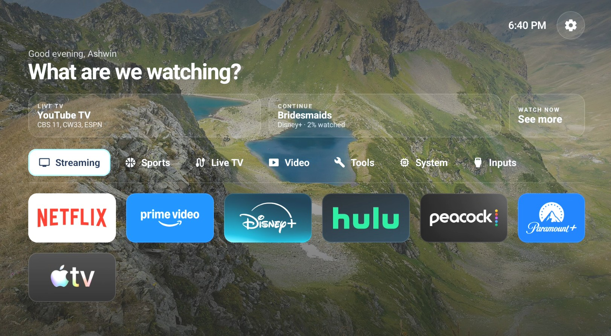
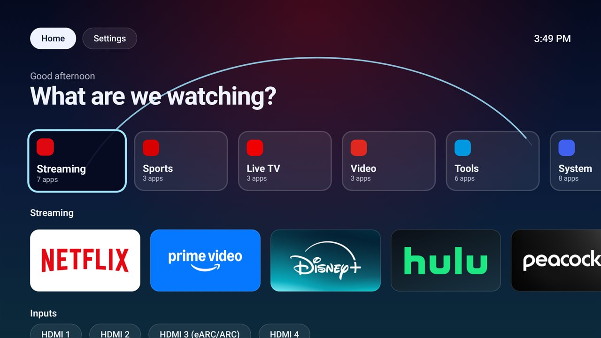
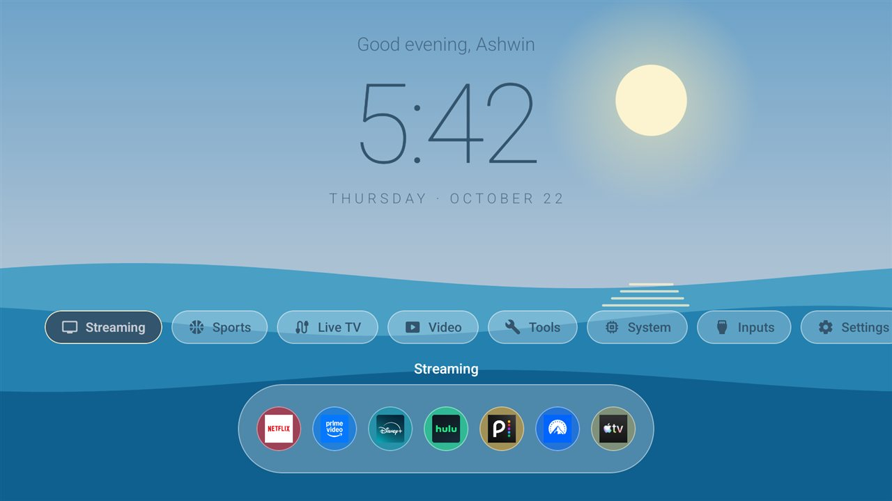
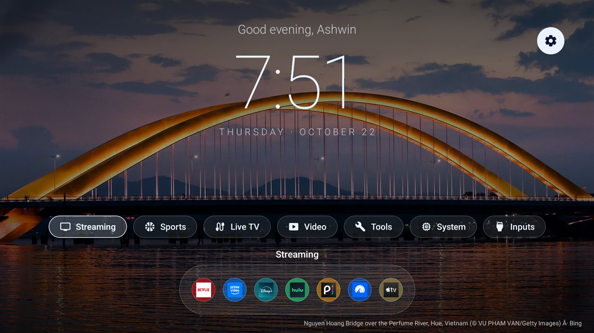
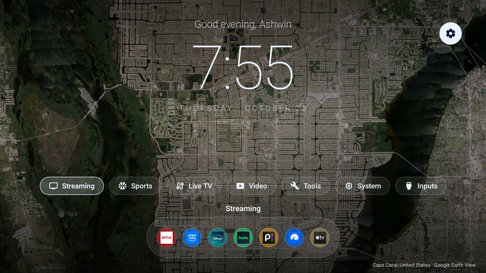
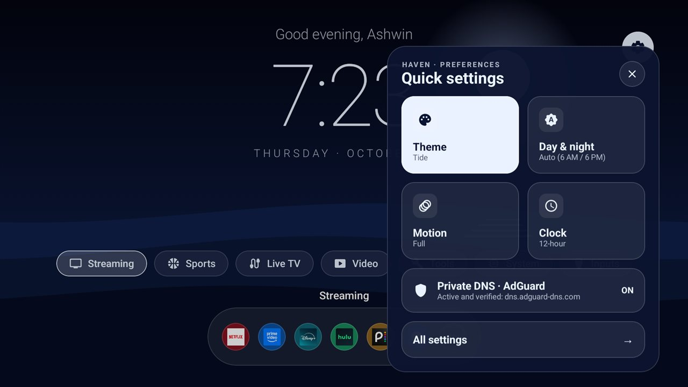

# Haven

An ad-free, glass-style home screen for Android TV / Google TV.

Haven replaces the stock Google TV home (and its ads and "recommended" rows) with a calm,
customizable launcher: your apps sorted into collections, themes that shift between day and
night, rotating photo wallpapers, and a few power tools like a Private DNS switch. Built for
and tested on a Sony BRAVIA running Google TV (Android 12).



## Features

- **Themes**: *Kingdom* (glass collection tiles with a glowing arc) and *Tide* (a big clock
  over animated waves). Colors blend from day to night around 6 AM and 6 PM, or stay fixed.
- **Collections**: apps are sorted into Streaming, Sports, Live TV, Video, Tools and System
  on first run. Move apps between collections, reorder anything, create and rename your own,
  pick an icon from 24, hide apps you don't use. HDMI inputs are a row of their own.
- **Real app art**: uses each app's own TV banner or icon; the glow follows the focused app's color.
- **Quick settings and Personalize**: a gear opens quick toggles; *All settings* opens a glass
  panel over the live home, so every change previews instantly. Settings are grouped into
  *Appearance* (theme, motion, wallpaper), *Home & layout* (cards, greeting, collections),
  *TV & network* (Home button, Private DNS) and *About & data*.
- **Photo wallpapers**: per theme, swap the animated scene for rotating photos from Bing,
  Google Earth View, Wikimedia Commons or Unsplash (topics like nature, animals, cities, sports).
  Changes every 1, 6, 12 or 24 hours.
- **Watch Now**: a slim strip on Home (Tonight / Continue / Live TV) and a glass drawer with
  *Continue Watching* and *Live Channels* from any app that shares them with Android TV, plus an
  optional NBA module: live scores, a 7-day schedule and date picker, a favorite team with its
  full season, and a game view with box-score leaders that opens the game in the NBA app.
- **Private DNS**: one switch for encrypted DNS (AdGuard by default, also Cloudflare, Quad9 or
  any hostname), with live status and an optional "keep enforced".
- **Home button**: makes the remote's Home button open Haven on Google TV.
- **Remote-first**: hold OK for options, rows wrap around end to end, greeting with your name,
  card size, motion level, 12/24-hour clock.

## Screenshots

| | |
|---|---|
|  |  |
| *Kingdom at night* | *Tide during the day* |
|  |  |
| *Photo wallpaper (Bing)* | *Photo wallpaper (Google Earth View)* |
|  | |
| *Quick settings* | |

## Build and install

Requirements: JDK 17, the Android SDK (platform 35), and `adb` with your TV's developer
mode and network debugging on.

1. Create a signing key and a `keystore.properties` in the project root (both are git-ignored):

   ```
   storeFile=keystore/haven-release.jks
   storePassword=...
   keyAlias=haven
   keyPassword=...
   ```

   ```bash
   keytool -genkeypair -keystore keystore/haven-release.jks -alias haven -keyalg RSA -keysize 2048 -validity 10000
   ```

2. Build and install:

   ```bash
   ./gradlew assembleRelease
   adb connect <tv-ip>:5555
   adb install -r -f app/build/outputs/apk/release/app-release.apk
   ```

   `install -r` updates in place and keeps your layout and settings. `-f` keeps Haven on the
   TV's own storage: if your TV uses a USB drive as storage, apps there load after boot and
   Android drops their accessibility services, which breaks the Home button. (The manifest's
   `internalOnly` isn't enough, since Android counts such a drive as internal.)

   Haven also backs up your setup automatically to `Download/Haven/haven-backup.json`; restore
   it from **All settings › About & data › Backup & reset**. Reading it after a reinstall needs:

   ```bash
   adb shell appops set com.aktvhome.launcher MANAGE_EXTERNAL_STORAGE allow
   ``` Keep your signing key
   safe: updates must be signed with the same key.

## One-time permissions (over ADB)

Some features use permissions a TV can't grant from its own UI:

```bash
# Private DNS switch and the Home button setting
adb shell pm grant com.aktvhome.launcher android.permission.WRITE_SECURE_SETTINGS

# Continue Watching and Live Channels in Watch Now
adb shell pm grant com.aktvhome.launcher android.permission.READ_TV_LISTINGS
```

## Making Haven the home screen

Google TV always opens its own launcher on Home, even when another app is set as default.
Haven includes a small accessibility service that only watches for the Google TV home page
and opens Haven instead; it reads nothing on screen. Turn it on in
**All settings › TV & network › Home button** (needs the `WRITE_SECURE_SETTINGS` grant above). If you use
another launcher with its own Home override (such as Projectivy), switch that one off.

## Watch Now and NBA

Continue Watching and Live Channels show whatever apps publish to Android TV's shared lists,
for any service; apps that don't publish (Netflix, Prime Video) won't appear. The NBA module is
off by default: turn it on in **All settings › Watching & alerts › Watch Now**, and pick a
favorite team there. Scores and schedules come from ESPN's public (unofficial) API; NBA's own
game IDs come from nba.com's games page so games open directly in the NBA app.

## Unsplash topics

Unsplash needs a free Access Key: create an app at <https://unsplash.com/oauth/applications>
and paste the key in **All settings › Appearance › Wallpaper › Unsplash key**. It's stored only on the TV.

## Project layout

- `data/` app list, HDMI inputs, collections (`LayoutStore`), settings, first-run sorting
  (`Defaults`), Private DNS, wallpapers, Home override
- `ui/kingdom/`, `ui/tide/` one folder per theme; each puts the settings gear at the top right
- `ui/settings/` Quick settings card and the Personalize panel (both float over the live home)
- `ui/theme/` theme colors and the day/night blend
- `ui/Icons.kt` collection icons; `ui/WrapRow.kt` rows that wrap end to end;
  `ui/Ambient.kt` frame clock for scene motion (works even with system animations off)

## Notes

- First-run sorting in `Defaults.kt` is tuned to the apps on my TV; anything unknown lands
  in *Other* and can be moved.
- Photo credits are shown on screen (required by Unsplash); Earth View's photo list comes from
  a public mirror of Google's retired feed.
- Licensed under the [MIT License](LICENSE).
- Not affiliated with Google, Sony or any streaming service. App names and logos shown in
  screenshots belong to their owners.
